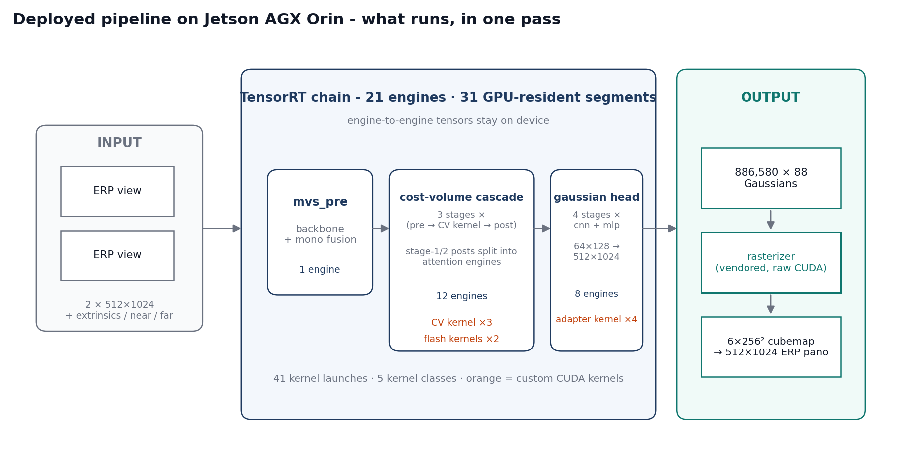
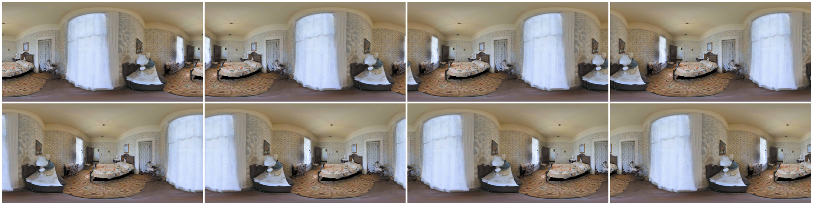
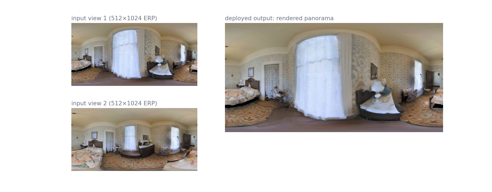
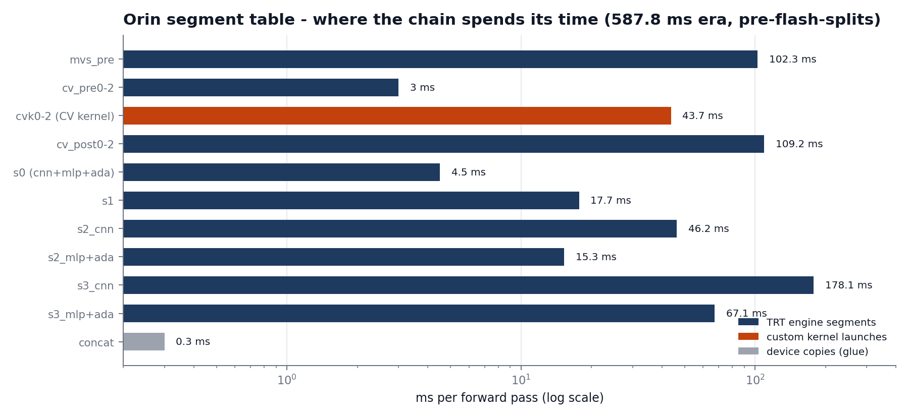
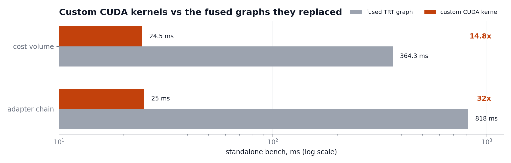
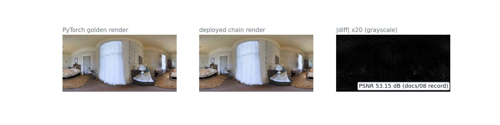

# PanSplat TRT Edge — Jetson AGX Orin Deployment

[PanSplat](https://github.com/chengzhag/PanSplat) (CVPR 2025) reconstructs a 3D Gaussian scene from two 512×1024 ERP panoramas in a single forward pass. On Jetson AGX Orin the stock PyTorch pipeline takes ~30 s per frame; deployed here as a 21-engine TensorRT chain it runs at **~567 ms end-to-end** — 53.7× over the same board’s eager baseline (chain-caliber ratio) — with no measurable quality loss (render PSNR 52.95 dB vs golden 52.96 dB). The star sub-result: replacing the fused cost-volume graph with one CUDA kernel alone recovers 320 ms (364.3 → 24.5 ms standalone, 14.8×).

<p align="center">
  
</p>

*The deployed one-pass pipeline: what runs on the Orin in one forward pass. Engine group counts from the committed engine manifest (cxx/runner.cu); layout figure generated from committed records, no measurement data. Engine-internal math stays FP32 (docs/01).*

## Demo

**360° sweep of the deployed chain's panorama render** (10 s, no audio):

<p align="center">
  <video src="https://github.com/user-attachments/assets/517c35b7-6e5b-4ed1-b57a-f380a3aef133" controls muted loop></video>
</p>

A yaw sweep at a fixed position equals an exact horizontal roll of the ERP image, so the sweep is an exact roll of the certified render - no re-render, no new numbers. If your renderer does not play the embed, the contact sheet below is the in-repo fallback; the master also ships as a v1.1.0 Release asset (render_sweep.mp4, 10 s H.264, 1024×512).

<p align="center">
  
</p>

*Golden-scene panorama, deployed-chain render (512×1024 ERP, mp3d-derived scene distributed with the HF artifacts repo). Render pair certified at the dev gate (docs/08, 4090 dev, 2026-10).*

## Results

Two latency calibers are reported separately and never mixed: the chain caliber (model-inference only) and the end-to-end caliber (chain + rendering). Headline subset only - the full records and the evidence chain live in [docs/08_results.md](docs/08_results.md); the measurement contract (platform, warmup/iteration policy, metadata block) in [docs/03_benchmark_contract.md](docs/03_benchmark_contract.md).

<p align="center">
  
</p>

*One transaction of the deployed chain: two input ERP views (left) → Gaussian field → rendered panorama (right). Golden-scene tier (mp3d-derived scene, anchor npz on the HF artifacts repo); right panel is the deployed-chain render certified at the dev gate (docs/08, 4090 dev, 2026-10). Single forward pass, no measurement data in this figure.*

**Chain latency (model-inference)** - Jetson AGX Orin 64GB, JetPack 6.2, TensorRT 10.3, MAXN + live clock readback (GR3D 1300.5 MHz), quiet window, 3 untimed warmup iterations then min/mean of N≥5 (2026-10 release re-run: N=50):

| Metric | Value |
|---|---|
| Reconstruction (2×512×1024 ERP → 886,580 Gaussians × 88 dims) | **546.3–551.2 ms** (min / mean) |
| 2026-10 release re-run (quiet cool window, 99% util) | 555.1 ms min / 556.4 ms mean (N=50), repeat 555.1–561.0 |
| Rendering (886,580 Gaussians → 6×256² cubemap → 512×1024 ERP) | 20.6 ms |
| vs PyTorch eager on the same Orin (30,000 ms, chain caliber) | **53.7×** (52.9× end-to-end) |
| RTX A6000 recon (TRT 10.16, shared card) | 129.97 ms (±10%) |

<p align="center">
  
</p>

*Where the half-second goes: per-segment time of the deployed chain (587.8 ms-era layout, pre-flash-splits; log scale). The release caliber 546.3–551.2 ms is after the flash splits — full 31-segment table and engine-boundary reasoning in [docs/01_architecture.md](docs/01_architecture.md).*

<p align="center">
  
</p>

*What the custom kernels bought: standalone benches, fused TRT graph vs custom CUDA kernel (log scale). Standalone caliber only — in-chain the CV kernel segment is 43.7 ms; flash has no standalone bench. Kernel methodology and the Myelin pathology classification in [docs/04_kernels.md](docs/04_kernels.md).*

**End-to-end & platform overhead**:

| Metric | Value |
|---|---|
| End-to-end (chain + render summed) | **~567 ms** |

**Accuracy gates (golden-anchor tier)**:

| Metric | Value |
|---|---|
| Gaussian fields cosine vs PyTorch golden (means/cov/harmonics/opacity) | ≥ 0.99978 per field |
| Render PSNR vs PyTorch golden render (same-env A/B) | 52.95 dB (golden 52.96 dB) |
| 2026-10 clean-room golden gate (A6000 / 4090 dev) | 4-field cosine PASS, render PSNR 53.22 / 53.15 dB (floor 52.0) |

<p align="center">
  
</p>

*Deployed-chain render vs PyTorch golden render, same Gaussians: left/middle near-identical, right = amplified |diff| (×20 grayscale). The PSNR annotation cites the committed docs/08 record (4090 dev gate, 2026-10); the Orin release round measured 52.95 dB (table above). PNG round-trip changes the number - the figure cites the record, not a recompute.*

## Architecture

The 2-view encoder traces to 23 ONNX graphs; 21 engines load at runtime: 1× mvs_pre (backbone + mono fusion), 12× cost-volume cascade (3 stages; the stage-1/2 refinements are split into attention engines around two custom flash-attention kernels), 8× gaussian head (4 stages × cnn+mlp). Segment boundaries follow compiler pathologies; engine-internal math stays FP32 while engines take FP16 inputs. Full segment table, engine-boundary reasoning, buffer-table design: [docs/01_architecture.md](docs/01_architecture.md). Kernel methodology and the Myelin pathology classification: [docs/04_kernels.md](docs/04_kernels.md). Feature-cache tier semantics for validation: [docs/05_accuracy.md](docs/05_accuracy.md).

## Quickstart

```bash
# 1. Environment (conda env from environment_strict.yaml; python 3.10, torch 2.4.0+cu118, TRT 10.3)
#    trtexec must be on PATH (engines are built with the TRT CLI only -
#    the pip python API segfaults on these graphs).

# 2. Checkpoint: download per ckpts/README.md into
#    logs/nvpl49ge/checkpoints/last.ckpt   (sha256 in ckpts/README.md)

# 3. Golden tier = the accuracy gate (needs the golden anchor npz -
#    dataset-free; fetch from the HF artifacts repo: https://huggingface.co/hous-lab/pansplat-trt-edge-orin)
#    - see export/README.md
PANSPLAT_INPUTS=golden bash run_pipeline.sh

# 4. Smoke tier (default): pipeline bring-up only. The 21-engine chain
#    bakes the golden-scene encoding - see docs/05_accuracy.md - so a
#    non-golden input set has no numerical meaning here.
bash run_pipeline.sh
```

The pipeline is 8 idempotent steps with `export/.ok/` sentinels: guard → runner inputs → ONNX export (23 graphs) → 21 trtexec engine builds → CUDA runner build → accuracy gates → latency bench → summary. `PANSPLAT_SKIP_EXPORT=1` validates HF-fetched ONNX against the manifest and skips tracing — see [docs/02_pipeline.md](docs/02_pipeline.md).

## Scope & limitations

- Single-scene feature-cache deployment: the gh_s*_cnn engines bake the golden-scene encoding, so numerical gates run on the golden-anchor tier ([docs/05_accuracy.md](docs/05_accuracy.md)); non-golden inputs are smoke-tier only.
- Not solved here: INT8 (three documented strikes, [docs/08_results.md](docs/08_results.md)), cold start (3.1–3.6 s, untreated), interactive viewing (the render bench is a benchmark binary, not a viewer), DLA.
- Conclusions are bound to the platform pairings in [docs/07_deployment.md](docs/07_deployment.md); engines are not portable across TRT versions or GPU architectures.
- The 256-res tier latency was measured (A6000 ~79 ms) but quality was never evaluated - decision data missing, tier frozen.
- Rendering envelope and the tile-parallelism floor: [docs/09_rendering.md](docs/09_rendering.md).

<p align="center">
  
</p>

*What a render costs anywhere: min ms per frame, 3 platforms × faces × resolution. The 128² tile-parallelism floor, phase decomposition, and knob studies in [docs/09_rendering.md](docs/09_rendering.md).*

## License

MIT for this deployment code; PanSplat model code © Cheng Zhang, MIT; the vendored rasterizer fork carries its own license — see [NOTICE](NOTICE). The PanSplat checkpoints remain under their original license and are link-only (see [ckpts/README.md](ckpts/README.md)).
