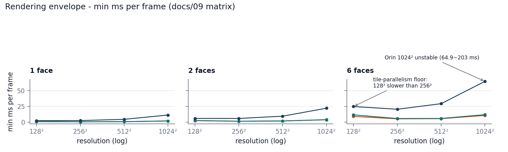

# Rendering envelope and the tile-parallelism floor

Owner of every rendering-envelope number in the repo (docs/08 owns the single 20.6 ms
headline render figure; this doc owns the full matrix, phase decomposition and knobs).

## Measurement metadata

- **What**: the vendored diff-gaussian-rasterization fork called directly via
  `Rasterizer::forward` (torch-free benchmarks `cxx/render_bench.cu` /
  `cxx/render_matrix.cu`; no torch overhead).
- **Scene**: golden mp3d scene, P = 886,580 Gaussians - the same field the
  deployed 21-engine chain emits.
- **Platforms**: RTX 4090 Laptop 16 GB (sm_89, CUDA 11.8); RTX A6000 (sm_86,
  CUDA 12.3); Jetson AGX Orin 64 GB (sm_87, JetPack 6.2 / L4T R36.5.0).
  The rasterizer is raw CUDA - TRT is irrelevant here.
- **Run mode**: 20-40 iterations per cell, min/avg reported.
- **Clock discipline**: x86 hosts run default clocks; Orin ran MAXN with live
  clock readback (<1% repeat jitter). jetson_clocks was NOT locked for the
  envelope runs (chain runs lock it) - treat the envelope as untuned-clock data.
- **Date**: 2026-10.
- **Cross-check**: nsys per-kernel aggregation (4090/A6000) vs cudaEvent
  instrumentation; the two methods agree within 5-15%.

## 1. Envelope matrix (min/avg ms)

The 6 × 256² row is the deployed decode shape: 20.54/20.64 ms on Orin - the
"20.6 ms render" figure quoted in the README and docs/08. Bit-exact across
platforms: per-face outputs are identical on 4090 / A6000 / Orin (same Gaussian
field, same rasterizer code path).

| Faces x res | 4090 Laptop | A6000 | Orin |
|---|---|---|---|
| 1 x 128² | 0.96/0.97 | 1.10/1.11 | 2.42/2.43 |
| 1 x 256² | 0.62/0.63 | 0.64/0.64 | 2.55/2.58 |
| 1 x 512² | 0.88/0.89 | 0.89/0.90 | 4.53/4.55 |
| 1 x 1024² | 1.93/1.97 | 2.02/2.05 | 11.39/11.41 |
| 2 x 128² | 2.45/2.45 | 2.67/2.71 | 5.98/6.00 |
| 2 x 256² | 1.57/1.61 | 1.51/1.51 | 5.92/5.96 |
| 2 x 512² | 1.99/2.03 | 1.92/1.94 | 9.54/9.59 |
| 2 x 1024² | 3.79/3.85 | 4.02/4.08 | 22.19/22.22 |
| 6 x 128² | 9.25/9.44 | 11.69/11.71 | 24.88/24.91 |
| 6 x 256² | 5.32/5.52 | 5.82/5.83 | 20.54/20.64 |
| 6 x 512² | 5.60/5.75 | 5.93/6.05 | 29.40/29.45 |
| 6 x 1024² | 10.73/11.13 | 11.97/12.04 | 64.9~203 / 65~198 |

Orin/4090 speed ratio grows with resolution: 2.5x (128²) -> 4.1x (256²) ->
5.1x (512²) -> 5.9x (1024²) at faces=1 - blend is bandwidth-bound, so higher
resolutions punish Orin harder.

<p align="center">
  
</p>

*Envelope matrix as lines: min ms per frame (best of the min/avg pair) vs resolution, per faces panel, three platforms (see matrix above). The 6×1024² Orin cell is a range (64.9~203 ms); the line plots the best value. Figure generated from the §1 matrix (drift-asserted maintainer-side script); no new numbers.*


## 2. The 128² anomaly: a tile-parallelism floor

128² is SLOWER than 256² on every platform (6 faces: 4090 9.25 vs 5.32 ms;
A6000 11.69 vs 5.82; Orin 24.88 vs 20.54). Mechanical cause: at 128² each face
is only 64 tiles, so 64 CTAs run - below the SM count - and the GPU cannot fill.
Each surviving tile serially blends a ~3900-Gaussian list.

FACT vs INTERPRETATION: the slowdown on all three platforms is fact; the floor
location (tiles ~ 2-4x SM count) is interpretation. Practical consequence: AR/VR
low-latency tiers cannot cross the floor by dropping resolution below 256².

## 3. Phase decomposition (6 × 256², us/face)

| Phase | 4090 | A6000 | Orin | Orin share |
|---|---|---|---|---|
| pre (projection+SH+cull, P threads) | 268.9 | 199.7 | 717.0 | 20.5% |
| scan (tiles_touched prefix sum) | 12.6 | 15.0 | 49.7 | 1.4% |
| d2h (num_rendered sync) | 9.8 | 9.0 | 26.5 | 0.8% |
| duplicate with extents | 34.6 | 34.9 | 165.1 | 4.7% |
| radix sort (cub SortPairs) | 100.7 | 127.3 | 409.9 | 11.7% |
| identifyTileRanges | 5.9 | 7.0 | 24.4 | 0.7% |
| render (blend) | 561.3 | 656.3 | 2109.1 | 60.2% |
| Total (us/face) | 994 | 1049 | 3502 | 100% |
| (wall-clock/6 cross-check) | 0.89-1.0 | 1.02 | 3.46 |  |

The sort pipeline (duplicate + radix sort + identifyTileRanges) totals 14.1%
(4090) / 16.1% (A6000) / 17.1% (Orin). Blend is the bottleneck at 56-63%;
pre (projection+SH+cull) is second at 19-27%. This contradicts the claim that
sort dominates in Gaussian splatting rasterizers at this scale.

## 4. Knobs

### SH evaluation (view-dependent color)

| Platform | DC-only (best/avg ms) | Savings vs SH path (same batch) |
|---|---|---|
| RTX 4090 Laptop | 4.29 / 4.30 | -1.40 ms |
| RTX A6000 | 5.28 / 5.29 | -0.73 ms |
| Jetson AGX Orin | 18.8 / 18.9 | -1.70 ms |

SH eval (deg-4, M=25, once per face, 6 per frame) costs 1.7 ms of the 20.5 ms
Orin render (8%, best vs best in the same batch). DC-only saves it but loses
view-dependent color. In this fork, SH->RGB happens inside the rasterizer
kernel (once per face); there is no separate torch SH op in the pipeline.

### What the 20.6 ms does not include

The 20.6 ms is the pure rasterizer (preprocess + binning + render, incl. 6 SH
evals). The deployed decode stage adds torch postprocessing on top: equirect
warp (grid_sample), cubemap concat, context fusion. On 4090 the torch path
measures ~14 ms vs the 5.7 ms bench - binding + warp + host-sync overhead.
The end-to-end 567 ms includes all of it.

## 5. Reproducing

```bash
# build (host CUDA toolkit required)
bash scripts/build_render_bench.sh <arch> <build_dir>   # arch: sm_89 / sm_86 / sm_87
# single config
DGR_SRC=third_party/diff-gaussian-rasterization-modified ITERS=20 \
  <build_dir>/render_bench export/render_bench
# full matrix sweep (faces x res)
DGR_SRC=third_party/diff-gaussian-rasterization-modified ITERS=20 \
  <build_dir>/render_matrix export/render_bench
```

Gaussian inputs live in `export/render_bench/` (means/cov/shs/opa `.f32` dumps
plus `faces.bin` camera records; the first 6 records are the golden render
settings). The dumps are gitignored build artifacts - regenerate from the chain
or fetch the golden anchor from the HF artifacts repo.
